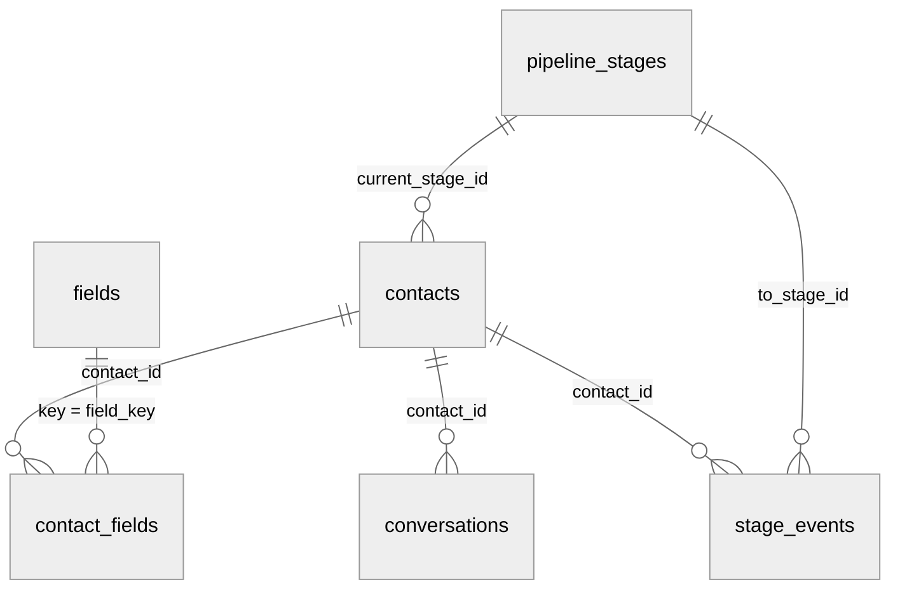

## Objetos

| Objeto | Endpoint | Leitura incremental por |
| --- | --- | --- |
| Contato | `/v1/contacts` e `/v1/contacts/{id}` | `updated_at` |
| Valor de campo | `/v1/contact_fields` | `updated_at` |
| Conversa | `/v1/conversations` | `updated_at` |
| Mudança de etapa | `/v1/stage_events` | `created_at` |
| Etapa | `/v1/pipeline_stages` | Página única |
| Campo | `/v1/fields` | Página única |
| Exclusão | `/v1/deletions` | `deleted_at` |

O significado de cada atributo está na [referência](/api-reference/introducao).

## Relacionamentos

- **Contato** é o objeto central. Conversas, valores de campo e mudanças de etapa
  apontam para ele por `contact_id`.
- **Etapa** e **Campo** são tabelas de referência. Use-as para traduzir
  `current_stage_id` e `field_key` em nomes legíveis.
- **Campo** é versionado: quando o tipo de um campo muda, nasce uma versão nova com a
  mesma `key`, e a anterior fica com `archived_at` preenchido. Para traduzir `field_key`,
  use a versão com `archived_at` nulo.
- **Valor de campo** usa formato longo: uma linha por contato e campo. Um campo novo na
  conta vira novas linhas, sem mudar o esquema da sua tabela.

## Convenções

- Respostas em JSON, com atributos planos (sem objetos aninhados) e nomes em
  `snake_case`.
- Datas em ISO 8601, sempre em UTC: `2026-10-13T14:02:11.000Z`.
- Telefones em E.164: `+5548999990000`.
- Atributo sem valor vem como `null`. Atributos nunca são omitidos.
- Identificadores são strings opacas. Não presuma formato nem ordem.

## O que não é exposto

A API não retorna o conteúdo das mensagens, os textos gerados pela IA sobre o contato
(resumos e justificativas), as instruções dos agentes nem os contatos criados no
ambiente de teste.

## Limitações conhecidas

- **Métricas da conversa.** Uma mensagem nova nem sempre atualiza o `updated_at` da
  conversa. Por isso `contact_message_count`, `agent_message_count` e
  `first_response_at` podem mudar sem que a conversa apareça na leitura incremental.
  Se você usa essas métricas, faça uma carga completa diária de `/v1/conversations`.
- **Origem da conversa.** Se a pessoa chegar por um segundo anúncio dentro da mesma
  conversa, os atributos `origin_*` passam a refletir o anúncio mais recente. Os
  atributos `first_origin_*` do contato vêm da primeira conversa com origem conhecida;
  se essa conversa receber um segundo anúncio, eles também passam a refletir o mais
  recente.
