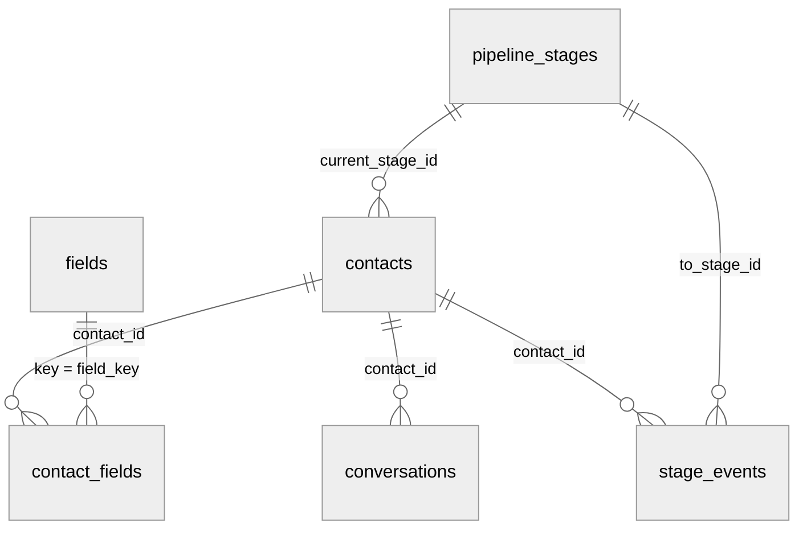

## Objetos

| Objeto | Endpoint | Chave primária | Filtro incremental |
| --- | --- | --- | --- |
| Contato | `/v1/contacts`, `/v1/contacts/{id}` | `id` | `updated_at` |
| Valor de campo | `/v1/contact_fields` | `contact_id`, `field_key` | `updated_at` |
| Conversa | `/v1/conversations` | `id` | `updated_at` |
| Mudança de etapa | `/v1/stage_events` | `id` | `created_at` (imutável) |
| Etapa | `/v1/pipeline_stages` | `id` | Página única |
| Campo | `/v1/fields` | `id` | Página única |
| Exclusão | `/v1/deletions` | `id` | `deleted_at` |

Atributos de cada objeto na [referência](/api-reference/introducao).

## Relacionamentos

- `contact_fields` está em formato longo: uma linha por contato e campo.
- `fields` é versionado: mudar o tipo de um campo cria uma versão nova com a mesma `key`
  e preenche `archived_at` na anterior.

## Convenções

- JSON com atributos planos, em `snake_case`. Todo atributo está sempre presente; sem
  valor, vem `null`.
- Datas em ISO 8601, em UTC.
- Telefones em E.164.
- Identificadores são strings opacas.
- Não são expostos: conteúdo das mensagens, textos gerados por IA sobre o contato,
  instruções dos agentes e contatos do ambiente de teste.
